# SkiTrak Assignment 2 — Test Results

## 1. Test environment

All instances are in AWS us-west-2. Times are UTC unless noted; the RabbitMQ UI shows UTC−6.

| Role | Name | Type | AZ | Notes |
|---|---|---|---|---|
| Broker | skitrak-rabbitmq | t3.small | us-west-2a | Amazon Linux 2023, Docker `rabbitmq:3.13-management` (RabbitMQ 3.13.7, Erlang 26.2.5.16) |
| Consumer | skitrak-consumer | t3.small | us-west-2a | Amazon Linux 2023, Corretto 17, systemd, `-Xmx1200m` |
| Ingest servers | skitrak-server-1..4 | t3.small | us-west-2a | Launched from an AMI of my A1 server (Tomcat 9) |
| Load client | skitrak-client | t3.large | us-west-2b | Same region: RTT ~8–12 ms instead of ~142 ms from my laptop |
| Load balancer | skitrak-alb | ALB, internet-facing | 2a + 2b | HTTP:80 → target group skitrak-ingest (HTTP:8080) |

- Target group health check: `/ski-servlet/health`, interval 30 s, timeout 5 s, healthy 2, unhealthy 3.
  Stickiness: load-balancer-generated cookie, 1 day. ALB idle timeout: 120 s.
  `curl -i` through the ALB returned `Set-Cookie: AWSALB=...` and `AWSALBCORS=...`.
- Topology, as confirmed in the RabbitMQ UI:
  - exchanges `skitrak.exchange` (topic), `leaderboard.fanout` (fanout), `skitrak.dlx` (fanout)
  - queues `resort.1..10` (D, TTL, Lim, Ovfl, DLX), `skitrak.dead` (D), and one `amq.gen-*` queue per server (AD, Excl)
- Startup checks: each server logged `server-v2 <host> connected to RabbitMQ, channel pool size 64`.
  The consumer health check returned `{"status":"UP","swipesProcessed":0,"queueDepth":0}`.
- Procedure: before each run I restarted the consumer (`systemctl restart skitrak-consumer`) to clear the in-memory
  aggregates and the eventId set. The exception is alb4-t512 (see §8).

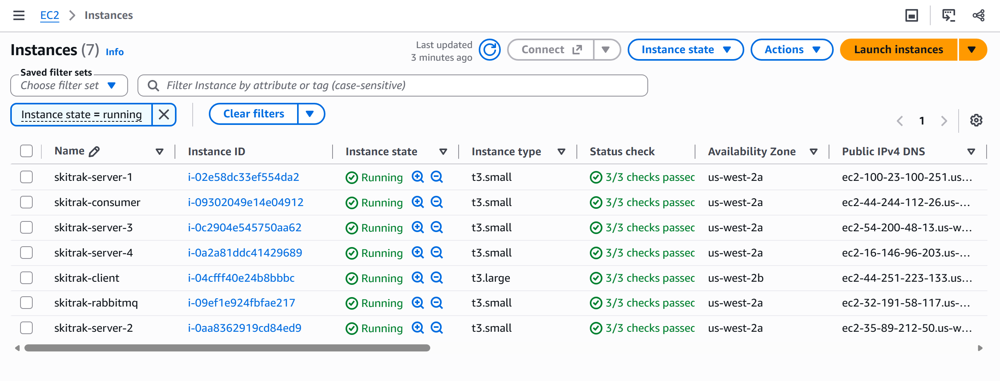
*All SkiTrak instances running: 4 ingest servers, consumer and broker (t3.small), and the client (t3.large).*

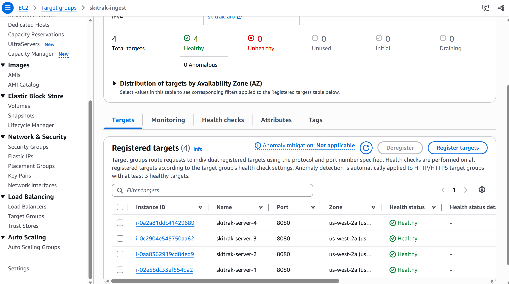
*Target group skitrak-ingest: 4 registered targets (skitrak-server-1..4, port 8080), all Healthy.*

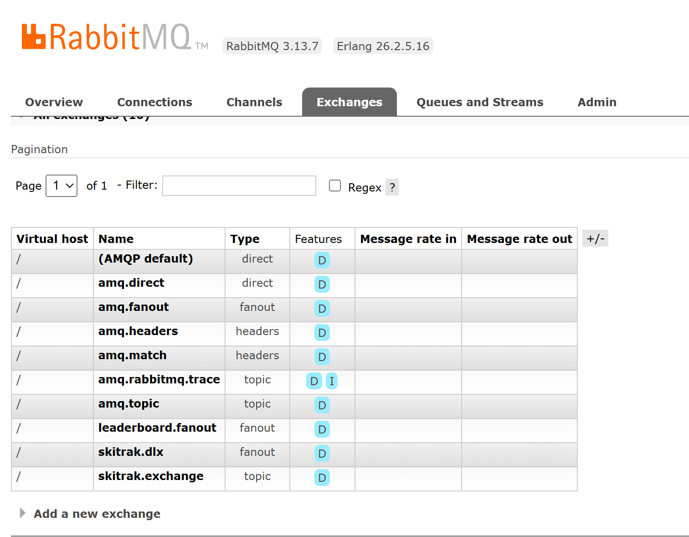
*RabbitMQ exchanges: `skitrak.exchange` (topic), `leaderboard.fanout` (fanout) and `skitrak.dlx` (fanout), all durable, next to the built-in exchanges.*

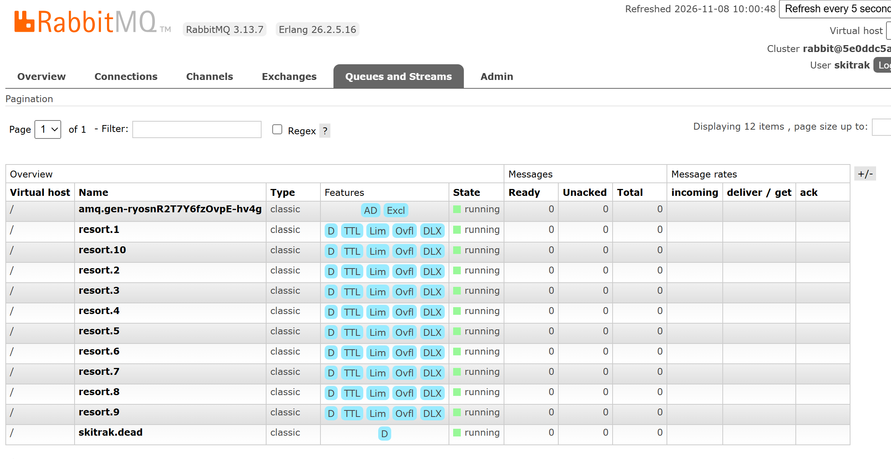
*RabbitMQ queues (taken 10:00 local, with one server deployed): `resort.1..10` with D/TTL/Lim/Ovfl/DLX, `skitrak.dead` (D), and that server's `amq.gen-*` backplane queue (AD, Excl).*

## 2. Run results

Every run had 0 failed swipes, 0 retries, 0 connection errors and 0 WebSocket reconnections. In every run,
each resort received about 10% of the swipes.

| Label | Servers | Client threads | Swipes | Wall time (ms) | Single-thread RTT | Warmup (32 thr) | Main phase | Overall |
|---|---|---|---|---|---|---|---|---|
| smoke (laptop → server-1) | 1 | 64 | 50,000 | 317,468 | 142.37 ms | 142/s | 194/s | 157/s |
| single-500k | 1 | 256 | 500,000 | 101,123 | 9.40 ms | 2,627/s | 5,262/s | **4,944/s** |
| alb2-500k | 2 | 256 | 500,000 | 85,791 | 9.68 ms | 2,828/s | 6,284/s | **5,828/s** |
| alb4-500k | 4 | 256 | 500,000 | 86,152 | 10.54 ms | 2,827/s | 6,254/s | **5,804/s** |
| alb4-1m | 4 | 256 | 1,000,000 | 161,924 | 11.53 ms | 2,795/s | 6,433/s | **6,176/s** |
| alb4-t512 (consumer not restarted) | 4 | 512 | 500,000 | 82,608 | 8.97 ms | 2,940/s | 6,525/s | 6,053/s |
| alb4-t512b (clean) | 4 | 512 | 500,000 | 84,770 | 8.26 ms | 2,641/s | 6,442/s | 5,898/s |

| Label | Ingest latency mean / median / p95 / p99 / max (ms) | Push latency median / p95 / p99 (ms) | Leaderboard updates | Little's Law prediction (main phase) |
|---|---|---|---|---|
| smoke | 259.81 / 250 / 368 / 475 / 1626 | 236 / 378 / 1696 | 640 | 450/s (warmup 225/s) |
| single-500k | 45.34 / 25 / 137 / 220 / 2234 | 4 / 32 / 118 | 1,353 | 27,234/s |
| alb2-500k | 38.47 / 37 / 66 / 99 / 455 | 9 / 21 / 56 | 1,350 | 26,457/s |
| alb4-500k | 38.69 / 37 / 63 / 87 / 251 | 12 / 25 / 70 | 1,300 | 24,281/s |
| alb4-1m | 38.67 / 37 / 62 / 91 / 374 | 14 / 25 / 56 | 1,636 | 22,203/s |
| alb4-t512 | 73.23 / 73 / 128 / 179 / 719 | 18 / 42 / 339,863 | 298 | 57,058/s |
| alb4-t512b | 74.27 / 73 / 130 / 178 / 965 | 11 / 28 / 71 | 1,319 | 62,002/s |

Full client outputs are in `results/<label>-output.txt`, and 10-second throughput buckets are in `results/<label>-throughput.csv`.

## 3. Real leaderboard evidence

Subscribers receive real, swipe-driven standings in every run. Each "Last Leaderboard Received" section lists real
skierIDs with accumulated vertical: about 600–980 ft in the smoke run, ~1,250–1,800 ft in the 500K runs, and
~1,670–2,120 ft in the 1M run. Here is the full single-500k block:

```
===== Last Leaderboard Received =====
Resort  1: {"resortID":"1","dayID":"1","serverTimestamp":"2026-11-08T16:37:02.835957402Z","top":[{"rank":1,"skierID":"94506","vertical":1434},{"rank":2,"skierID":"10517","vertical":1391},{"rank":3,"skierID":"29384","vertical":1374},{"rank":4,"skierID":"84823","vertical":1363},{"rank":5,"skierID":"5746","vertical":1327},{"rank":6,"skierID":"14014","vertical":1321},{"rank":7,"skierID":"15682","vertical":1320},{"rank":8,"skierID":"49864","vertical":1304},{"rank":9,"skierID":"12964","vertical":1294},{"rank":10,"skierID":"95723","vertical":1294}]}
Resort  2: {"resortID":"2","dayID":"1","serverTimestamp":"2026-11-08T16:37:00.474954282Z","top":[{"rank":1,"skierID":"23265","vertical":1572},{"rank":2,"skierID":"49680","vertical":1469},{"rank":3,"skierID":"15576","vertical":1443},{"rank":4,"skierID":"40351","vertical":1442},{"rank":5,"skierID":"12788","vertical":1356},{"rank":6,"skierID":"59908","vertical":1356},{"rank":7,"skierID":"25336","vertical":1312},{"rank":8,"skierID":"77835","vertical":1304},{"rank":9,"skierID":"67544","vertical":1267},{"rank":10,"skierID":"17233","vertical":1260}]}
Resort  3: {"resortID":"3","dayID":"1","serverTimestamp":"2026-11-08T16:37:03.470546358Z","top":[{"rank":1,"skierID":"75385","vertical":1529},{"rank":2,"skierID":"24542","vertical":1512},{"rank":3,"skierID":"44151","vertical":1486},{"rank":4,"skierID":"23481","vertical":1372},{"rank":5,"skierID":"4388","vertical":1347},{"rank":6,"skierID":"3858","vertical":1320},{"rank":7,"skierID":"23941","vertical":1320},{"rank":8,"skierID":"37516","vertical":1287},{"rank":9,"skierID":"77623","vertical":1260},{"rank":10,"skierID":"81159","vertical":1242}]}
Resort  4: {"resortID":"4","dayID":"1","serverTimestamp":"2026-11-08T16:36:59.198375176Z","top":[{"rank":1,"skierID":"25912","vertical":1434},{"rank":2,"skierID":"69311","vertical":1433},{"rank":3,"skierID":"28838","vertical":1415},{"rank":4,"skierID":"19844","vertical":1407},{"rank":5,"skierID":"45233","vertical":1346},{"rank":6,"skierID":"31583","vertical":1336},{"rank":7,"skierID":"5237","vertical":1330},{"rank":8,"skierID":"34281","vertical":1322},{"rank":9,"skierID":"75999","vertical":1321},{"rank":10,"skierID":"52251","vertical":1312}]}
Resort  5: {"resortID":"5","dayID":"1","serverTimestamp":"2026-11-08T16:37:03.280388499Z","top":[{"rank":1,"skierID":"48660","vertical":1582},{"rank":2,"skierID":"94554","vertical":1581},{"rank":3,"skierID":"47813","vertical":1511},{"rank":4,"skierID":"78545","vertical":1468},{"rank":5,"skierID":"86687","vertical":1451},{"rank":6,"skierID":"44483","vertical":1443},{"rank":7,"skierID":"50314","vertical":1390},{"rank":8,"skierID":"38921","vertical":1365},{"rank":9,"skierID":"12481","vertical":1355},{"rank":10,"skierID":"49618","vertical":1354}]}
Resort  6: {"resortID":"6","dayID":"1","serverTimestamp":"2026-11-08T16:36:58.058541977Z","top":[{"rank":1,"skierID":"66864","vertical":1625},{"rank":2,"skierID":"20136","vertical":1580},{"rank":3,"skierID":"70180","vertical":1469},{"rank":4,"skierID":"37695","vertical":1407},{"rank":5,"skierID":"14095","vertical":1400},{"rank":6,"skierID":"92131","vertical":1381},{"rank":7,"skierID":"6747","vertical":1312},{"rank":8,"skierID":"87871","vertical":1312},{"rank":9,"skierID":"5923","vertical":1286},{"rank":10,"skierID":"88359","vertical":1269}]}
Resort  7: {"resortID":"7","dayID":"1","serverTimestamp":"2026-11-08T16:37:03.515046298Z","top":[{"rank":1,"skierID":"29470","vertical":1573},{"rank":2,"skierID":"49728","vertical":1425},{"rank":3,"skierID":"25597","vertical":1380},{"rank":4,"skierID":"16426","vertical":1373},{"rank":5,"skierID":"17521","vertical":1373},{"rank":6,"skierID":"88500","vertical":1347},{"rank":7,"skierID":"12058","vertical":1311},{"rank":8,"skierID":"21824","vertical":1303},{"rank":9,"skierID":"64776","vertical":1295},{"rank":10,"skierID":"67741","vertical":1293}]}
Resort  8: {"resortID":"8","dayID":"1","serverTimestamp":"2026-11-08T16:37:00.778227809Z","top":[{"rank":1,"skierID":"32420","vertical":1529},{"rank":2,"skierID":"86398","vertical":1477},{"rank":3,"skierID":"40751","vertical":1469},{"rank":4,"skierID":"83062","vertical":1433},{"rank":5,"skierID":"98197","vertical":1426},{"rank":6,"skierID":"10582","vertical":1417},{"rank":7,"skierID":"46528","vertical":1356},{"rank":8,"skierID":"39711","vertical":1348},{"rank":9,"skierID":"32188","vertical":1348},{"rank":10,"skierID":"18178","vertical":1329}]}
Resort  9: {"resortID":"9","dayID":"1","serverTimestamp":"2026-11-08T16:37:02.982358472Z","top":[{"rank":1,"skierID":"15612","vertical":1765},{"rank":2,"skierID":"61336","vertical":1505},{"rank":3,"skierID":"22830","vertical":1383},{"rank":4,"skierID":"99354","vertical":1381},{"rank":5,"skierID":"25727","vertical":1380},{"rank":6,"skierID":"15007","vertical":1330},{"rank":7,"skierID":"83525","vertical":1313},{"rank":8,"skierID":"43774","vertical":1313},{"rank":9,"skierID":"8083","vertical":1311},{"rank":10,"skierID":"59795","vertical":1304}]}
Resort 10: {"resortID":"10","dayID":"1","serverTimestamp":"2026-11-08T16:37:00.058022458Z","top":[{"rank":1,"skierID":"54955","vertical":1504},{"rank":2,"skierID":"83188","vertical":1469},{"rank":3,"skierID":"40311","vertical":1460},{"rank":4,"skierID":"71138","vertical":1459},{"rank":5,"skierID":"54870","vertical":1390},{"rank":6,"skierID":"45912","vertical":1372},{"rank":7,"skierID":"90771","vertical":1338},{"rank":8,"skierID":"34351","vertical":1330},{"rank":9,"skierID":"75826","vertical":1329},{"rank":10,"skierID":"12542","vertical":1322}]}
```

## 4. Queue metrics

**single-500k** (RabbitMQ Overview, last minute): publish, deliver and consumer-ack rates overlapped at approx.
5.4k msg/s. Queued messages stayed at approx. 30–40 during the run and returned to 0 afterwards.

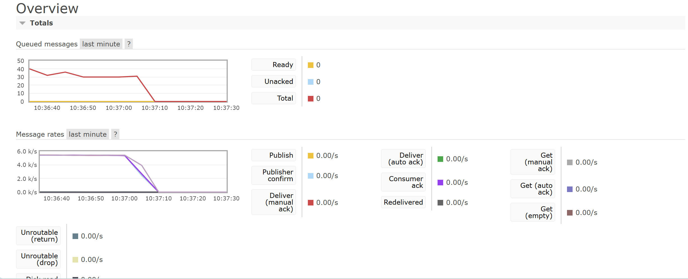
*RabbitMQ Overview, single-500k run: rates overlap at ~5.4k msg/s and the queue holds a low plateau.*

**alb4-1m** (`queue_monitor.py` every 5 s, summarized by `summarize_queue.py`):

```
Samples (active / total): 31 / 45
Peak queue depth:   265
Avg queue depth:    105
Avg producer rate:  5932 msg/s
Avg consumer rate:  6047 msg/s
Peak producer rate: 7303 msg/s
Peak consumer rate: 6840 msg/s
```

Depth fluctuated between roughly 60 and 180 with no upward trend, which is a stable plateau.

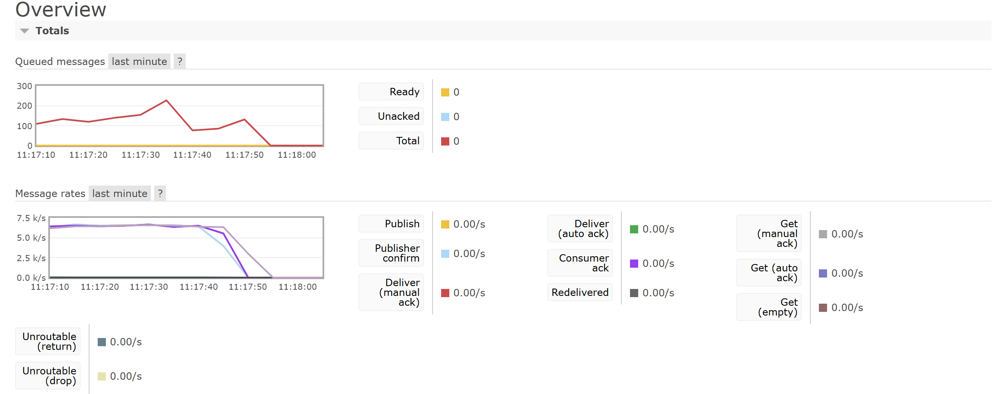
*RabbitMQ overview, last minute, end of the alb4-500k run (4 instances, 256 client threads).*

**All load-balanced runs** (Overview, last hour, local UTC−6): peaks at 11:01 alb2 (queue approx. 260, the highest point on this graph; hourly
averaging smooths the 1M run's measured peak of 265), 11:16 alb4-500k (approx. 100), 11:22 alb4-1m (the widest), 11:29 alb4-t512 and 11:34 alb4-t512b (approx. 150).
The queue returned to 0 after every run. At the one-hour scale each point averages a time window, so plateaus look
like spikes and rates look lower than the per-run measurements.

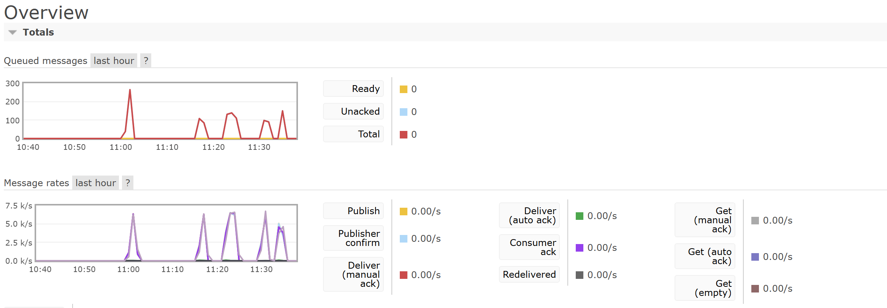
*RabbitMQ Overview, last hour (local UTC−6). Queue peaks: 11:01 alb2-500k, 11:16 alb4-500k, 11:22 alb4-1m, 11:29 alb4-t512, 11:34 alb4-t512b. Queued messages return to 0 after each run.*

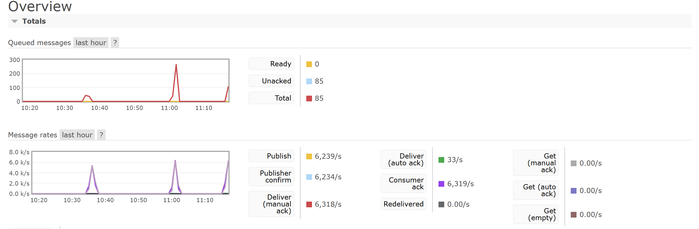
*RabbitMQ overview, last hour, captured at 11:18 (UTC−6). It shows the single-instance run (10:36, queue ~40) and the 2-instance run (11:01, queue ~260). The right edge is the alb4-500k run still in progress.*

All runs stayed far below the 1,000-message depth target.

## 5. Part 4 target metrics

The consumer logs one line every 5 s (`processed`, `avgLag`, `queueDepth`, `threads`, `duplicates`). Its systemd
journal from 16:30 UTC is saved in `results/consumer-journal.txt`. `results/summarize_consumer.awk` splits the
journal at each consumer restart and reports the final counters of each segment:

```
$ awk -f results/summarize_consumer.awk results/consumer-journal.txt
run ending 2026-11-08T16:34:17+0000: processed=50100 maxLag=0ms maxThreads=2 duplicates=0
run ending 2026-11-08T17:00:23+0000: processed=500100 maxLag=43ms maxThreads=2 duplicates=0
run ending 2026-11-08T17:16:15+0000: processed=500100 maxLag=33ms maxThreads=2 duplicates=0
run ending 2026-11-08T17:21:56+0000: processed=500100 maxLag=23ms maxThreads=2 duplicates=0
run ending 2026-11-08T17:33:45+0000: processed=1500200 maxLag=62ms maxThreads=2 duplicates=0
run ending 2026-11-08T18:20:08+0000: processed=500100 maxLag=57ms maxThreads=2 duplicates=0
```

| Segment | Client successful swipes | Consumer processed | Max 5 s avg lag | Duplicates |
|---|---|---|---|---|
| smoke | 50,000 | 50,100 | not saved (2–4 ms at start) | 0 |
| single-500k | 500,000 | 500,100 | 43 ms | 0 |
| alb2-500k | 500,000 | 500,100 | 33 ms | 0 |
| alb4-500k | 500,000 | 500,100 | 23 ms | 0 |
| alb4-1m + alb4-t512 (no restart between them) | 1,000,000 + 500,000 | 1,500,200 | 62 ms | 0 |
| alb4-t512b | 500,000 | 500,100 | 57 ms | 0 |

**Queue depth < 1,000.** The highest measured total depth (ready + unacked) was 265, in the 1M run (`queue_monitor.py`).
The graphs show approx. 30–40 for single-500k and a peak of 265 (1M run, measured) for the load-balanced runs (§4).

**No swipe loss.** In every segment, consumer processed = client successful swipes + 100. Before warmup, the client
measures single-thread RTT by sending `LITTLES_LAW_SAMPLES = 100` real swipes (`Main.measureSingleThreadRtt`). The
server stores these like any other swipe, but they are not counted in the client's success total. The segment without a
restart matches too: 1,500,200 = 1,000,100 + 500,100. Duplicates were 0 in every run, so no swipe was counted twice.

**Consumer lag < 100 ms.** The highest 5-second average lag across all runs was 62 ms. The smoke segment reports 0 ms
because the saved journal starts at 16:30, after the smoke run ended (16:14). The consumer log for the smoke run was not
saved; the only lines I captured, at the very start of that run, showed avgLag 2–4 ms.

**Dynamic scaling.** The pool stayed at its minimum of 2 threads in every run, and 2 threads kept up with ~6k msg/s.
That is consistent with the broker, not the consumer, being the bottleneck (§8). The scaler doubles the pool when the
depth it reads exceeds 500. It reads depth with `messageCount`, which counts only ready messages. With prefetch 100
on each of the 10 channels, queued messages were already delivered to the consumer and held as unacked, so the ready
count in the log stayed at 0 throughout. The RabbitMQ UI confirms this split: Ready 0 and Unacked 85 in
the last-hour screenshot captured at 11:18 (§4). Even total depth (peak 265) stayed below the 500 threshold.

## 6. Load distribution and stickiness

- **2-server run.** The Tomcat access log on server-2 counted **250,049** `POST /ski-servlet/skiers` requests, which is 50.01% of
  500,000. Server-1 therefore handled 249,951. Only the 2026-11-08 file is from this test; the older files came from the A1 AMI.

```
$ grep -c "POST /ski-servlet/skiers" /opt/tomcat9/logs/localhost_access_log.*
/opt/tomcat9/logs/localhost_access_log.2026-09-12.txt:0
/opt/tomcat9/logs/localhost_access_log.2026-10-16.txt:2046679
/opt/tomcat9/logs/localhost_access_log.2026-11-08.txt:250049
```

- **Sticky cookie.** `curl -i http://<ALB>/ski-servlet/health`:

```
HTTP/1.1 200 OK
Date: Sun, 08 Nov 2026 17:00:00 GMT
Content-Type: application/json;charset=UTF-8
Set-Cookie: AWSALB=...; Expires=Sun, 15 Nov 2026 17:00:00 GMT; Path=/
Set-Cookie: AWSALBCORS=...; Expires=Sun, 15 Nov 2026 17:00:00 GMT; Path=/;SameSite=None
Content-Length: 16

{"message":"OK"}
```

- **CloudWatch RequestCountPerTarget** shows the traffic spike at ~17:00 UTC. This metric is the average per healthy
  target, not a per-instance breakdown.

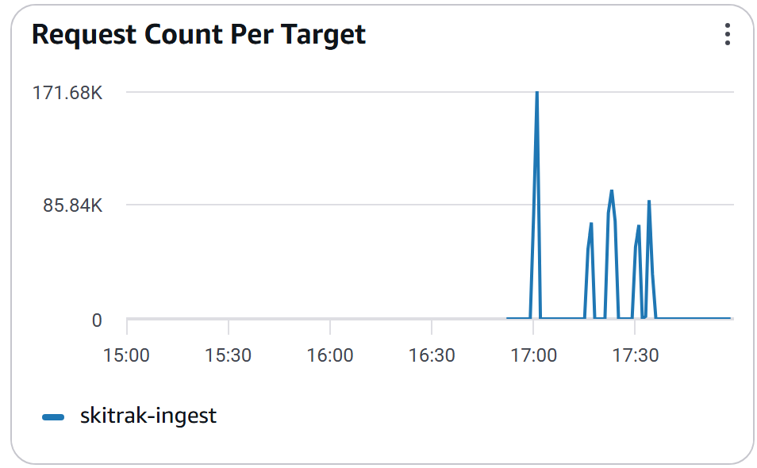
*CloudWatch RequestCountPerTarget, target group skitrak-ingest (UTC). The tallest spike is at ~17:00 (alb2-500k, 2 targets);
the smaller spikes after 17:15 are the 4-target runs. The metric is the average per healthy target.*

- **Stickiness.** The ingest HTTP client does not store cookies, so ALB stickiness did not pin POSTs to one server, and
  they were spread evenly. Each WebSocket stayed on the server that accepted it: there were 0 reconnections in every run.
  Because of the backplane, every server receives every leaderboard update, so a subscriber is served correctly
  on any target.

## 7. Resource utilization

**vmstat on the RabbitMQ host** (5 s interval, run alb4-t512; consumer state does not affect ingest load):

| | us | sy | id | wa | bo |
|---|---|---|---|---|---|
| main phase | 65–78 | 20–25 | 1–2 | 0 (7–8 only in the first seconds) | ~13,600–14,900 KB/s (persistent writes) |
| alb4-t512b (only the last ~10 s captured) | 72–75 | 23–27 | 1–2 | | |

So the broker CPU was 95–99% busy in the main phase. Main-phase excerpt:

```
 r  b   swpd   free   buff  cache   si   so    bi    bo   in   cs us sy id wa st
 4  0      0 318252   2168 1151252    0    0     0 14946 18306 13015 72 23  5  0  0
 2  0      0 332280   2168 1131560    0    0     0 14468 17413 11587 76 22  2  0  0
 2  1      0 328744   2168 1126808    0    0     0 13946 17309 11240 78 21  1  0  0
 6  0      0 325148   2168 1143332    0    0     0 14246 17236 11280 76 23  1  0  0
 2  1      0 312456   2168 1159196    0    0     0 13832 18007 10943 76 23  1  0  0
 4  0      0 316800   2168 1139636    0    0     0 14307 18659 11773 78 21  1  0  0
 2  0      0 305996   2168 1156052    0    0     0 13953 17458 10949 77 22  1  0  0
```

**vmstat on the client** (alb4-t512): idle was 0–6% during warmup/ramp-up. In the main phase, idle was 18–28%, steal 5–8%
and the run queue reached up to ~49. Main-phase excerpt:

```
 r  b   swpd   free   buff  cache   si   so    bi    bo   in   cs us sy id wa st
49  0      0 5871884   2168 764516    0    0     0     0 21606 50089 56 36  7  0  2
10  0      0 5863824   2168 764516    0    0     0     0 19189 41150 39 28 28  0  6
16  0      0 5861332   2168 764516    0    0     0    23 22502 49478 41 33 20  0  5
18  0      0 5859892   2168 764516    0    0     0     0 21771 49081 41 33 19  0  7
16  0      0 5857860   2168 764516    0    0     0     0 21307 48637 43 34 18  0  6
19  0      0 5854360   2168 764516    0    0     0     0 21625 48948 39 32 21  0  8
23  0      0 5853192   2168 764516    0    0     0     0 21521 48497 38 32 22  0  8
```

**EC2 CPU utilization, RabbitMQ host** (CloudWatch 5-minute averages, approx.):

| Time | Run | CPU |
|---|---|---|
| 17:00 | alb2 | ~26% |
| 17:20 | 1M | 43.53% (peak 5-minute average) |
| 17:30 | t512 | ~32% |

The CPU credit balance kept rising, so the instance was not throttled. Each run lasted only 1.5–2.7 min, so the 5-minute
averages include idle time and understate in-run load. vmstat is the direct measurement.

**EC2 CPU utilization, all roles** (CloudWatch 5-minute averages, UTC). The top y-axis label of each chart is the
highest 5-minute average in the window, not an instantaneous value during a run:

| Instance | Peak 5-minute average | What the chart shows |
|---|---|---|
| skitrak-rabbitmq | 43.53% | Highest of the four. Rises at ~17:00, peaks at ~17:20 (1M run), stays elevated through ~17:35 |
| skitrak-client | 40.53% | Peaks around 17:20 with a second peak near 17:30, then drops to 0 after ~17:40 |
| skitrak-server-1 | 14.31% | The same two-peak shape at a much lower level |
| skitrak-consumer | 12.94% | The same two-peak shape at a much lower level |

The ingest server and the consumer stay low, while the broker carries the highest load, which matches the vmstat result.

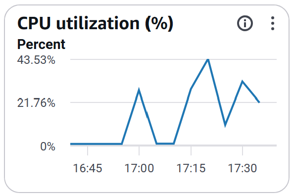
*skitrak-rabbitmq CPU, 5-minute averages (peak 5-minute average 43.53%).*

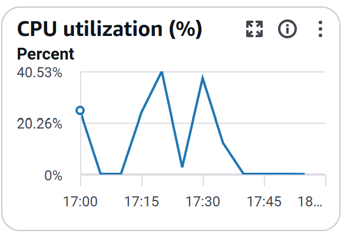
*skitrak-client CPU, 5-minute averages (peak 5-minute average 40.53%).*

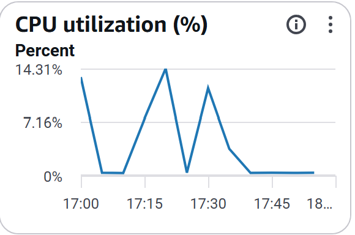
*skitrak-server-1 CPU, 5-minute averages (peak 5-minute average 14.31%).*

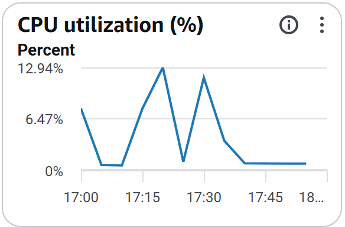
*skitrak-consumer CPU, 5-minute averages (peak 5-minute average 12.94%).*

## 8. Analysis

**Laptop smoke test.** From my laptop, single-thread RTT was 142 ms and the client measured 157 swipes/s overall. Little's
Law predicted 225 req/s for the 32-thread warmup. Under load, though, median latency rose to ~250 ms, and
32 / 0.25 s ≈ 128 req/s matches the measured 142/s. The consumer was idle and queue depth stayed at 0, so the bottleneck
was the network from my laptop. For this reason, all performance runs used a client EC2 instance in the same region.

**Single instance.** The run processed 500,000 swipes with no failures at 4,944 swipes/s overall (5,262/s main phase).
Publish, deliver and ack rates stayed equal at ~5.4k msg/s, and queue depth stayed at ~30–40, a stable plateau, so the
consumer kept up. Little's Law predicted 27,234 req/s from the 9.4 ms single-thread RTT. Under load, mean latency rose
to ~45 ms, and 256 / 0.045 s ≈ 5,700 req/s matches the measurement.

**1 → 2 instances.** Throughput rose 18% (4,944 → 5,828 overall; 5,262 → 6,284 main phase) and tail latency roughly
halved (p95 137 → 66 ms, p99 220 → 99 ms). Spreading requests over two servers removed most of the queueing on a single
server. The ALB split the load evenly (250,049 vs 249,951).

**2 → 4 instances.** Throughput did not increase (main phase 6,284 → 6,254/s), and mean latency stayed at ~38 ms. If the
ingest servers were still the bottleneck, halving each server's load would have lowered latency. The bottleneck had
therefore moved downstream of the servers.

**1M stress test.** The run processed 1,000,000 swipes with no failures at 6,176 swipes/s overall (6,433/s main phase), the
same rate as the 500K run, with p99 at 91 ms. Over ~2.5 min, queue depth stayed between ~60 and 180 (peak 265, average 105) with
no upward trend. The average consumer rate (6,047 msg/s) matched the producer rate (5,932 msg/s). The system was stable
under sustained load, and the consumer was not the bottleneck.

**256 → 512 client threads.** Main-phase throughput rose only 3% (6,254 → 6,442/s), while mean latency nearly doubled
(39 → 74 ms). The extra concurrency only added queueing, so the system was saturated downstream of the client. vmstat
showed the RabbitMQ host at 95–99% CPU with near-zero I/O wait, while the client still had ~20% idle CPU in the main
phase.

**Bottleneck.** The bottleneck is the CPU of the single t3.small RabbitMQ broker. Each swipe costs the broker a persistent publish,
a publisher confirm, a delivery and a manual ack, plus leaderboard fan-out to every server. Adding ingest servers
beyond two therefore cannot raise throughput. Options:

- a larger broker instance
- batched or asynchronous publisher confirms
- batched consumer acks
- throttled leaderboard broadcasts
- non-persistent messages, if some loss were acceptable

**Measurement finding (push latency).** In run alb4-t512 the consumer was not restarted, because the restart command
failed on a pasted control sequence. Push-latency p99 jumped to ~340 s, about the gap since the previous run. The server
sends its cached latest leaderboard to each new subscriber on connect. That snapshot came from the previous run, so its
serverTimestamp was minutes old. Normally these 10 initial messages are diluted by more than 1,000 live updates. Here,
because the top 10 already held high values from the previous run, only 298 updates occurred, and the stale snapshots
dominated p99. After restarting the consumer (alb4-t512b), p99 returned to 71 ms. A more accurate push-latency
measurement should exclude each subscriber's first message.

**Known limitation (eventId dedupe).** The server generates the eventId. Dedupe therefore catches broker redeliveries, but not
a client retry after a lost 201, because the retry gets a new eventId. Fixing this needs a client-generated ID, which
changes the A1 API.

## 9. Changes made during deployment

- `deployment/consumer/skitrak-consumer.service`: `-Xmx2g` → `-Xmx1200m`. The consumer host (t3.small) has 2 GB of total RAM,
  so a 2 GB heap risked an OOM kill.
- On the client instance, I created the results/ folder before the runs so that tee could write each run's output.
- The consumer was restarted before each run so that aggregates and the dedupe set do not carry over between runs.

## Appendix: Raw client output
Copied from the client output files. The leaderboard JSON section is omitted (see §3).

### single-500k (`results/single-500k-output.txt`)

```
===== Ingest Path =====
Successful swipes:   500000
Failed swipes:       0
Retries:             0
Connection errors:   0
Warmup:  32 threads, 12183 ms, 2627 swipes/s
Main:    256 threads, 88940 ms, 5262 swipes/s
Total wall time: 101123 ms
Overall throughput: 4944 swipes/s
HTTP connections: 1 shared HttpClient for ingest (HTTP/1.1 keep-alive pool), 1 separate HttpClient for WebSockets

===== Subscribe Path =====
Resort  1: 135 updates, connect 38 ms, 0 reconnections
Resort  2: 132 updates, connect 13 ms, 0 reconnections
Resort  3: 137 updates, connect 49 ms, 0 reconnections
Resort  4: 137 updates, connect 11 ms, 0 reconnections
Resort  5: 131 updates, connect 8 ms, 0 reconnections
Resort  6: 134 updates, connect 10 ms, 0 reconnections
Resort  7: 138 updates, connect 11 ms, 0 reconnections
Resort  8: 130 updates, connect 8 ms, 0 reconnections
Resort  9: 140 updates, connect 8 ms, 0 reconnections
Resort 10: 139 updates, connect 10 ms, 0 reconnections

===== Performance Analysis =====
Ingest latency (n=500000): mean=45.34, median=25, p95=137, p99=220, min=4, max=2234 (ms)
Throughput per resort:
  Resort  1: 49873 swipes, 493 swipes/s
  Resort  2: 50037 swipes, 495 swipes/s
  Resort  3: 49688 swipes, 491 swipes/s
  Resort  4: 49982 swipes, 494 swipes/s
  Resort  5: 50436 swipes, 499 swipes/s
  Resort  6: 49779 swipes, 492 swipes/s
  Resort  7: 50048 swipes, 495 swipes/s
  Resort  8: 49897 swipes, 493 swipes/s
  Resort  9: 50168 swipes, 496 swipes/s
  Resort 10: 50092 swipes, 495 swipes/s
Push latency (n=1353): mean=9.11, median=4, p95=32, p99=118, min=1, max=399 (ms)
Total leaderboard updates delivered: 1353
Note: push latency includes clock skew between client and server clocks.
```

### alb2-500k (`results/alb2-500k-output.txt`)

```
===== Ingest Path =====
Successful swipes:   500000
Failed swipes:       0
Retries:             0
Connection errors:   0
Warmup:  32 threads, 11317 ms, 2828 swipes/s
Main:    256 threads, 74474 ms, 6284 swipes/s
Total wall time: 85791 ms
Overall throughput: 5828 swipes/s
HTTP connections: 1 shared HttpClient for ingest (HTTP/1.1 keep-alive pool), 1 separate HttpClient for WebSockets

===== Subscribe Path =====
Resort  1: 135 updates, connect 31 ms, 0 reconnections
Resort  2: 153 updates, connect 33 ms, 0 reconnections
Resort  3: 125 updates, connect 7 ms, 0 reconnections
Resort  4: 127 updates, connect 7 ms, 0 reconnections
Resort  5: 130 updates, connect 11 ms, 0 reconnections
Resort  6: 137 updates, connect 6 ms, 0 reconnections
Resort  7: 133 updates, connect 11 ms, 0 reconnections
Resort  8: 153 updates, connect 6 ms, 0 reconnections
Resort  9: 127 updates, connect 8 ms, 0 reconnections
Resort 10: 130 updates, connect 7 ms, 0 reconnections

===== Performance Analysis =====
Ingest latency (n=500000): mean=38.47, median=37, p95=66, p99=99, min=4, max=455 (ms)
Throughput per resort:
  Resort  1: 49981 swipes, 583 swipes/s
  Resort  2: 49848 swipes, 581 swipes/s
  Resort  3: 49759 swipes, 580 swipes/s
  Resort  4: 49848 swipes, 581 swipes/s
  Resort  5: 49984 swipes, 583 swipes/s
  Resort  6: 50062 swipes, 584 swipes/s
  Resort  7: 50255 swipes, 586 swipes/s
  Resort  8: 50548 swipes, 589 swipes/s
  Resort  9: 49664 swipes, 579 swipes/s
  Resort 10: 50051 swipes, 583 swipes/s
Push latency (n=1350): mean=10.73, median=9, p95=21, p99=56, min=1, max=340 (ms)
Total leaderboard updates delivered: 1350
Note: push latency includes clock skew between client and server clocks.
```

### alb4-500k (`results/alb4-500k-output.txt`)

```
===== Ingest Path =====
Successful swipes:   500000
Failed swipes:       0
Retries:             0
Connection errors:   0
Warmup:  32 threads, 11320 ms, 2827 swipes/s
Main:    256 threads, 74832 ms, 6254 swipes/s
Total wall time: 86152 ms
Overall throughput: 5804 swipes/s
HTTP connections: 1 shared HttpClient for ingest (HTTP/1.1 keep-alive pool), 1 separate HttpClient for WebSockets

===== Subscribe Path =====
Resort  1: 131 updates, connect 34 ms, 0 reconnections
Resort  2: 139 updates, connect 34 ms, 0 reconnections
Resort  3: 130 updates, connect 36 ms, 0 reconnections
Resort  4: 125 updates, connect 13 ms, 0 reconnections
Resort  5: 129 updates, connect 40 ms, 0 reconnections
Resort  6: 120 updates, connect 17 ms, 0 reconnections
Resort  7: 129 updates, connect 7 ms, 0 reconnections
Resort  8: 144 updates, connect 7 ms, 0 reconnections
Resort  9: 128 updates, connect 12 ms, 0 reconnections
Resort 10: 125 updates, connect 8 ms, 0 reconnections

===== Performance Analysis =====
Ingest latency (n=500000): mean=38.69, median=37, p95=63, p99=87, min=4, max=251 (ms)
Throughput per resort:
  Resort  1: 50373 swipes, 585 swipes/s
  Resort  2: 50107 swipes, 582 swipes/s
  Resort  3: 49793 swipes, 578 swipes/s
  Resort  4: 49820 swipes, 578 swipes/s
  Resort  5: 50111 swipes, 582 swipes/s
  Resort  6: 49958 swipes, 580 swipes/s
  Resort  7: 49970 swipes, 580 swipes/s
  Resort  8: 50123 swipes, 582 swipes/s
  Resort  9: 49981 swipes, 580 swipes/s
  Resort 10: 49764 swipes, 578 swipes/s
Push latency (n=1300): mean=13.95, median=12, p95=25, p99=70, min=1, max=483 (ms)
Total leaderboard updates delivered: 1300
Note: push latency includes clock skew between client and server clocks.
```
